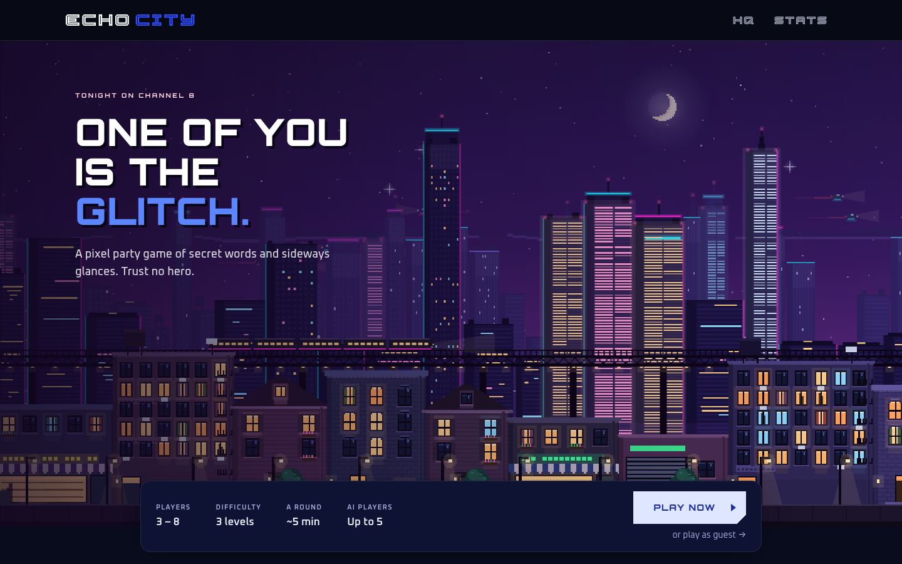
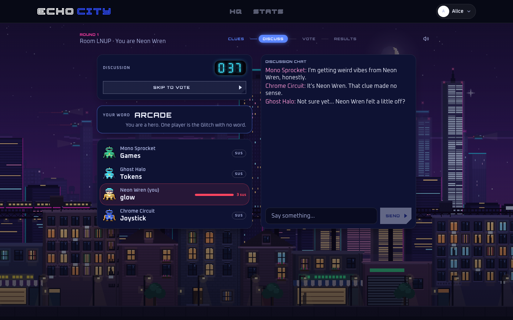

# Echo City

A real-time social deduction word game set in a neon pixel-art city.

**Play it:** https://echocity.app.space



## What it is

Everyone in the room shares one secret word, except **the Glitch**, who has no word and has to bluff. Players take turns giving one-word clues, flag suspects with live **SUS** meters, then vote. If the Glitch is caught, they get one last guess at the word to steal the win.

Play with friends using a 4-letter room code, or solo against up to 5 AI players. No account? **Play as guest** runs a full round against AI players in your browser.

## How to play

1. **Get your word.** Heroes all see the same word. The Glitch sees "NO WORD".
2. **Give clues.** One word each, in turn. Hint at the word without saying it. Too obvious and the Glitch can guess it.
3. **Discuss.** Chat, and tap **SUS** on whoever's clue didn't fit. Everyone sees the suspicion meters. Mention an AI player by name and it answers.
4. **Vote.** Catching the Glitch needs more than half the votes (e.g. 3 of 4).
5. **Results.** A caught Glitch gets one guess at the word. Points: Glitch escapes +200, each hero +100 when heroes win, +50 for voting for the Glitch.

Difficulty: **Rookie** (one lap of clues), **Hero** and **Legend** (two laps, closer words).



## Tech stack

- [DeepSpace](https://deep.space) SDK on Cloudflare Workers (Durable Objects for real-time records and presence)
- React 19, Vite 8, Tailwind CSS 4, React Router with file-based routes
- Pixel-art scenes generated in code as SVG (`src/components/game/PixelScene.tsx`), no image assets
- Fonts: Orbitron (headlines) and Oxanium (body); custom SVG lettering for the logo
- Vitest for unit tests, Playwright for browser checks

## Architecture

All game logic is **server-authoritative**. The browser only ever asks; server actions decide.

- **Server actions** (`src/actions/game.ts`): create/join rooms, deal words, take clues, run votes and score. Every action loads the room and checks the caller is seated (and is the host where needed) before changing anything.
- **Row permissions** (`src/schemas/game-schemas.ts`):
  - `assignments` (your word or "Glitch") and `votes` are **owner-only**: each browser receives only its own row.
  - `secrets` (who the Glitch is, the word) are **readable by nobody**. Only server actions touch them; the truth reaches players only in the round result.
  - `chats` and `sus` are the only client-writable collections, limited to a few fields. Bot chat lines use a server-only `speakerId` column that clients cannot write.
  - Users can read only their own user record; other players only ever see names, hero aliases and avatars, never emails.
- **Locks** (`locks` collection, unique key): every once-per-round step (deal, each clue turn, vote, scoring, each bot chat line) takes a lock first, so concurrent clients and retries can never double-deal, double-score or double-post.
- **Presence**: the lobby shows who is online via the SDK's presence hook.
- **Auth**: Google/GitHub sign-in through DeepSpace. The landing page and guest round are public; creating or joining a room requires sign-in. DeepSpace does not allow anonymous or self-created accounts, so guest play runs entirely in the browser (`src/pages/guest.tsx`) and saves nothing.

### Why the AI players are rule-based by default

Echo City is a public link. Calling a paid model for every bot clue, vote and narration would cost money per round and could be abused by anyone opening rooms. So by default:

- **AI players** (`src/game/bots.ts`) use hand-written hint lists for every word, vote from SUS taps plus how badly each player's clue fits their own word, and chat with short personality lines (max 3 per bot per round).
- **The narrator** uses the browser's free `speechSynthesis`, behind the mute toggle.
- The original Claude bots and ElevenLabs narrator are still in `src/game/ai.ts`, behind a server-side `AI_ENABLED` flag that defaults to off.

## Run locally

Requirements: Node 22.15+ (or 24/26) and npm 11.6+.

```sh
npm install
npx deepspace auth login     # once
npx deepspace dev start      # http://localhost:5173
```

Local dev can sign you in automatically as test players, which makes multiplayer testing easy:

- Create test accounts: `npx deepspace test accounts create --email <name>@deepspace.test --name "<Name>" --password-stdin`
- Put them in a gitignored `.env.development.local`:
  `VITE_DEV_PLAYERS=Alice:<email>:<password>,Bob:<email>:<password>`
- Open `http://localhost:5173/home?player=bob` in another window to play as Bob.

This is guarded by `import.meta.env.DEV`, so it is compiled out of production builds entirely.

Use Chrome for local testing: Safari rejects the dev session cookie on plain `http://localhost`.

## Checks

```sh
npm run type-check
npm run lint
npm run test:unit
npm run build
```

## Deploy

```sh
git push
npx deepspace auth whoami
npx deepspace deploy         # https://echocity.app.space
npx deepspace logs --since 15m
```

To turn on paid AI (optional): set `AI_ENABLED = "true"` for the app's environment and redeploy.

## Known gaps / next steps

- Smarter AI votes (they still split often, so heroes lose a lot)
- A no-repeat Glitch rotation so the role spreads evenly
- Optional Claude-powered bots when `AI_ENABLED` is on
